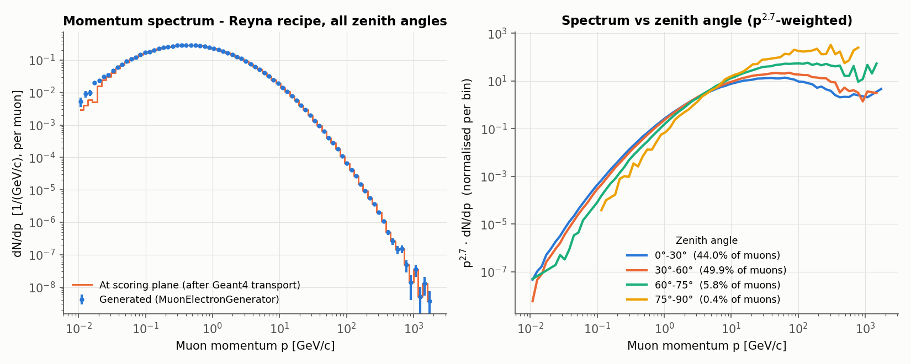
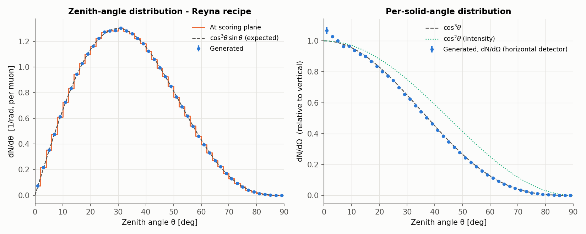
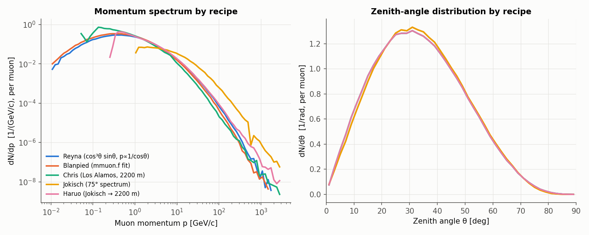

# MuonElectronGenerator
Cosmic ray generator for GEANT4
//
// Id: MuonElectronGenerator.cc,v 0.1 2004/10/18 by KBor
//                              v 1.0 2005/04/19 by KBor
//                              v 1.1 2009/02/04 by KBor
//                              v 1.2 2011/06/06 by KBor
//                              v 1.3 2011/07/20 by KBor
//                              v 1.4 2012/08/29 by KBor
//                              v 1.5 2013/04/26 by KBor
//
// Recent versions include multiple recipes to generate muon spectrum
// instead of single recipe by Blanpied
// The otehr recipes include:
// Reyna - Zenith spectrum from PDG modified by Reyna's method
// Jokisch - 75 deg Jokisch et al. (PR D19, 5, 1368, 1979) spectrum
// Haruo - Jokisch (75 deg) spectrum transformed to LA altitude 2200 m
// Chris - @LA high-altitude spectrum (2200m)
//
// based of FORTRAN file mmuon.f by Gary Blanpied
// with multiple changes in implementation by KBor
// aimed to expand energy range to higher energies,
// smooth generated spectrum at lower energies and
// use less memory (data array of 300 logarithmic energy bins
// instead of 10000 linear energy bins)
//
// constructor of the class initializes variables and then
// function GenerateMuon() generates muon
//
// Here is usage example (in another class in GEANT4):
// avkPrimaryGeneratorAction::avkPrimaryGeneratorAction()
 // {
// ...
// MEGen = new MuonElectronGenerator();
//...
//}
//void avkPrimaryGeneratorAction::GeneratePrimaries(G4Event* anEvent)
//{
//  MEGen->GenerateMuon();
//
//  G4ParticleDefinition* particle;
//  particle = MEGen->GetType();
//  particleGun->SetParticleDefinition(particle);
//  G4float momentum = (MEGen->GetEnergy())*GeV;
//  G4float mass = (G4float)particle->GetPDGMass();
//  G4float energy = sqrt (mass*mass + momentum*momentum);
//
//  // set particle kinetic energy to the gun/
//  particleGun->SetParticleEnergy(energy-mass);
//  G4double theta = (G4double)MEGen->GetZenithAngle();
//  ...
// }
// --------------------------------------------------------------
// Other comments:
// - iif input file with list of random numbers can be used for debugging
//   purposes. It may be obsolete, but I leave this feature (definetely,
//   not a bug!) commented for now
// - I consider use of single theta-momentum integral instead of
//   separate theta and momentum integrals. It would save one call
//   of random generator, but make the text more cryptic ... 
//
// Here is usage example (in another class in GEANT4):
// avkPrimaryGeneratorAction::avkPrimaryGeneratorAction()

`MuonElectronGenerator` samples cosmic-ray muons (and optionally electrons) for use as primaries
in a Geant4 simulation: particle type (mu-/mu+ = 45:55), zenith angle and momentum (GeV/c),
according to one of several recipes:

| Recipe     | Zenith angle                      | Momentum spectrum                                        |
|------------|-----------------------------------|----------------------------------------------------------|
| `Reyna`    | cos³θ·sinθ                        | vertical spectrum scaled as p/cosθ (hep-ph/0604145)      |
| `Blanpied` | from the angle-dependent fit      | log Φ = a(θ)log²E + b(θ)logE + c(θ) (after G. Blanpied's `mmuon.f`) |
| `Chris`    | cos³θ·sinθ                        | tabulated Los Alamos spectrum (2200 m)                   |
| `Jokisch`  | Blanpied                          | Jokisch et al., PRD 19, 1368 (1979), 75° spectrum         |
| `Haruo`    | cos³θ·sinθ                        | Jokisch 75° spectrum transformed to 2200 m, scaled with θ |

Cumulative tables are computed on first use and cached as `*.list` files in the working directory.

## Minimal usage

```cpp
MT_Random rng;  rng.init_random(1759319, 0);
auto gen = new MuonElectronGenerator(&rng, "Reyna");
gen->GenerateMuon("Reyna");
G4ParticleDefinition* particle = gen->GetType();
G4double p     = gen->GetEnergy() * GeV;        // momentum
G4double theta = gen->GetZenithAngle() * deg;   // zenith angle
G4double mass  = particle->GetPDGMass();
particleGun->SetParticleEnergy(std::sqrt(p*p + mass*mass) - mass);  // kinetic energy
```

## Example Geant4 application

`example/CosmicMuonSim` is a stand-alone Geant4 application (with `main()`) that launches muons from
the generator into air, records them at generation and at a horizontal scoring plane (CSV ntuples),
and plots the energy spectrum and angular distributions. Tested with Geant4 11.4.3 (GCC 9.4, CMake 3.16).

```bash
source <geant4-install>/bin/geant4.sh
cd example/CosmicMuonSim
./run_all.sh 1000000          # builds, runs all recipes, writes plots/ (needs numpy + matplotlib)
# or a single run:
mkdir build && cd build && cmake .. && make
./cosmic_muons Reyna 100000 muons_Reyna    # -> muons_Reyna_nt_generated.csv, muons_Reyna_nt_plane.csv
```





Note: `PrimaryGeneratorAction.cc` in the repository root is an experiment-specific example (needs ROOT
and `container`); it is not used by `example/CosmicMuonSim`.
